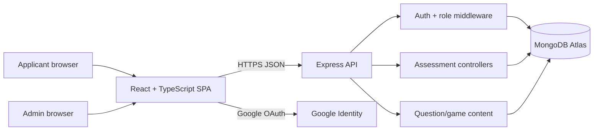
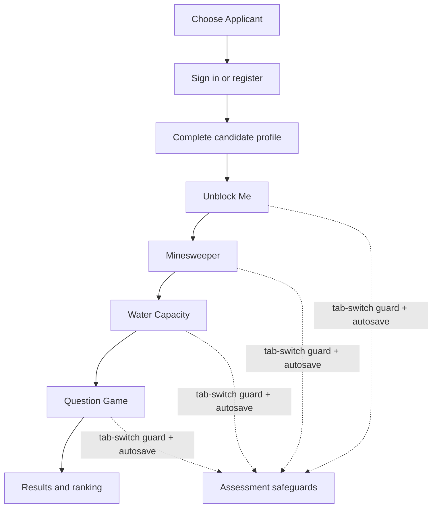
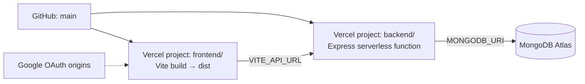

# IFA SkillQuest architecture

IFA SkillQuest separates the candidate experience from the hiring operations
surface while sharing one assessment API and MongoDB data layer.

## Platform architecture

## Candidate assessment flow

## Deployment topology

## Design principles

- **Signal over spectacle:** the interface uses clear progress, timing, and
  score states so candidates know what matters.
- **One visual language:** indigo identifies primary actions, cyan identifies
  progress and system health, and amber marks attention or milestones.
- **Separation of concerns:** React owns interaction and presentation, Express
  owns validation and persistence, and MongoDB remains the source of truth.
- **Safe configuration:** secrets stay in Vercel environment variables and are
  never committed to the repository.
